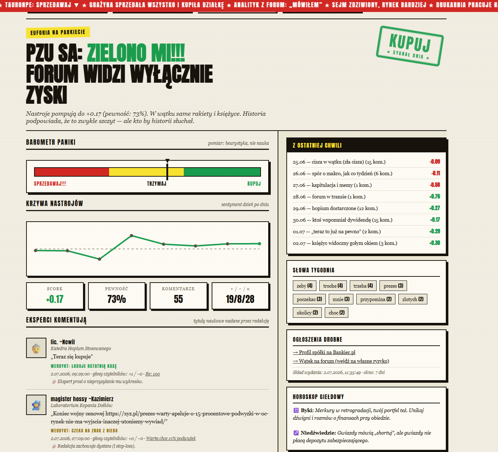

# Bankier Street Bets

[](https://github.com/110kc3/bankier-street-bets/actions/workflows/test.yml)
[](LICENSE)

Satirical **Buy / Hold / Sell** signal generator for Warsaw Stock Exchange (GPW) equities, driven by sentiment analysis of retail investor comments on the Bankier.pl forums.



## Highlights

- **Sentiment Engine:** Stem-based Polish lexicon scoring with inflection tolerance, slang detection, and community upvote weighting
- **Dynamic Window Escalation:** Automatically widens sampling windows for low-liquidity forum threads
- **Static Architecture:** Automated GitHub Actions scraping pipeline publishing static JSON to a vintage tabloid-styled GitHub Pages frontend
- **Zero-Dependency Native Tests:** Comprehensive suite covering collector pagination, scoring heuristics, and frontend rendering

## Quick Start

```bash
npm install
npm test
npm run serve
```

Visit `http://localhost:4173`.

## Refreshing Data

```bash
# Refresh a single ticker:
node scripts/refresh-stock.js EUVIC 7 30 200

# Refresh all configured equities:
npm run refresh
```

## Documentation

- [Portfolio Audit (2026-11-07)](docs/REPO-AUDIT-2026-11-07.md)
